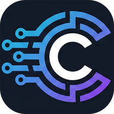
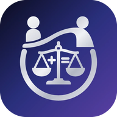
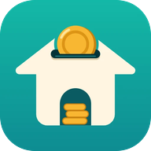

# Can Erdem Tükenmez

**.NET backend & cross-platform mobile developer** · İzmir, Türkiye

[canerdemtukenmez.com.tr](https://canerdemtukenmez.com.tr) · [cordeliasoftware.net](https://cordeliasoftware.net) · [LinkedIn](https://www.linkedin.com/in/can-erdem-tukenmez/)

**EN** · I build web apps and APIs on .NET. Under my personal brand **Cordelia Software** I design, build and publish iOS and Android apps with .NET MAUI, backed by ASP.NET Core APIs that I host and run myself on Linux. The source code is private; the apps are live on the App Store and Google Play.

**TR** · .NET ile web uygulamaları ve API'ler geliştiriyorum. Kişisel markam **Cordelia Software** altında .NET MAUI ile iOS ve Android uygulamaları tasarlayıp yayınlıyorum; arkalarındaki ASP.NET Core API'lerini kendi Linux sunucumda çalıştırıyorum. Kaynak kodları gizli; uygulamalar App Store ve Google Play'de.

## Apps · Uygulamalar

<table>
  <tr>
    <td align="center" width="104"></td>
    <td>
      <b>Kişi Başı</b> 
      Split shared expenses with friends on trips, at home or at events, and always know who owes whom. 
      <i>Tatilde, evde, etkinlikte ortak harcamaları arkadaşlarınla bölüş; kim kime ne kadar borçlu, Kişi Başı hesaplasın.</i> 
      .NET MAUI · ASP.NET Core · SignalR · EF Core · MariaDB 
      
      
    </td>
  </tr>
  <tr>
    <td align="center" width="104"></td>
    <td>
      <b>SporkoLig</b> 
      Run football, basketball and volleyball leagues with friends: enter the score once, and standings, top scorers and player cards update themselves. 
      <i>Arkadaşlarınla futbol, basketbol ve voleybol ligleri kur; maçı bir kez gir, puan durumu, gol krallığı ve oyuncu kartları kendiliğinden güncellensin.</i> 
      .NET MAUI · ASP.NET Core · EF Core · MariaDB · Firebase 
      
      
    </td>
  </tr>
  <tr>
    <td align="center" width="104"></td>
    <td>
      <b>Nöbetçi Eczane Bulucu TR</b> 
      Find on-duty pharmacies anywhere in Türkiye and Northern Cyprus: the nearest one on the map, one-tap call and directions. 
      <i>Türkiye ve KKTC'nin her yerinde nöbetçi eczaneyi bul; en yakını haritada, tek dokunuşla ara ve yol tarifi al.</i> 
      .NET MAUI Maps · ASP.NET Core Minimal API · Worker Service · OSRM · MySQL 
      
      
    </td>
  </tr>
  <tr>
    <td align="center" width="104"></td>
    <td>
      <b>Hesap Radarı</b> 
      See the bill before you go: restaurant and café prices from real receipts shared by users. 
      <i>Gitmeden önce hesabı gör: restoran ve kafe fiyatları, kullanıcıların paylaştığı gerçek adisyonlardan.</i> 
      .NET MAUI · ASP.NET Core · MariaDB · OCR (ML Kit / Apple Vision, Tesseract) 
      
      
    </td>
  </tr>
  <tr>
    <td align="center" width="104"></td>
    <td>
      <b>Bütçe Planla</b> · Budget Planner: Family &amp; Solo 
      See the end of the month today: salary, rent, loans and cards in one plan; personal or shared family budget. 
      <i>Ay sonunu bugünden gör: maaş, kira, kredi ve kartlar tek planda; kişisel ya da ortak aile bütçesi.</i> 
      .NET MAUI · ASP.NET Core · EF Core · MySQL · Firebase 
      
      
    </td>
  </tr>
</table>
